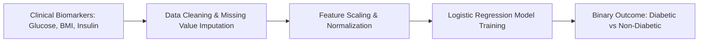

<p align="center">
  
</p>

<p align="center">
    
</p>


## 📌 Table of Contents
- [📖 Executive Summary](#-executive-summary)
- [✨ Key Features & Capabilities](#-key-features--capabilities)
- [🏗️ System Architecture & Workflow](#️-system-architecture--workflow)
- [🛠️ Tech Stack Breakdown](#️-tech-stack-breakdown)
- [⚙️ Reproducible Quickstart & Setup](#️-reproducible-quickstart--setup)
- [📂 Project Directory Layout](#-project-directory-layout)
- [👩‍💻 Author & Contributions](#-author--contributions)

---

## 📖 Executive Summary
### Problem Statement
Early detection of metabolic conditions like Type 2 diabetes is critical for preventive intervention. Diagnostic biomarkers must be evaluated through statistically sound machine learning classification.

### Motivation & Solution Overview
Supervised clinical machine learning pipeline analyzing the National Institute of Diabetes and Digestive and Kidney Diseases (NIDDK) Pima Indians dataset using Logistic Regression with feature scaling and train-test evaluation.

---

## ✨ Key Features & Capabilities
- **Clinical Biomarkers Analyzed:** Glucose levels, Blood Pressure, Insulin, BMI, Diabetes Pedigree Function, Age, and Pregnancies.
- **Preprocessing:** Handling biologically impossible zero-values through imputations and normalization.
- **Classification:** Trained Logistic Regression classifier evaluated on test splits.

---

## 🏗️ System Architecture & Workflow


---

## 🛠️ Tech Stack Breakdown
| Category | Technologies |
|---|---|
| **Language** | Python 3.9+ |
| **Libraries** | Scikit-learn, Pandas, NumPy, Matplotlib |
| **Dataset** | Pima Indians Diabetes Dataset (NIDDK) |

---

## ⚙️ Reproducible Quickstart & Setup
### How to Run
```bash
git clone https://github.com/Bhumikaravi/PIIMA-indians-Diabetes.git
cd PIIMA-indians-Diabetes
pip install numpy pandas scikit-learn matplotlib jupyter
jupyter notebook "Logistic Regression dataset (2).ipynb"
```

---

## 📂 Project Directory Layout
```text
PIIMA-indians-Diabetes/
├── Logistic Regression dataset (2).ipynb # End-to-end ML notebook
└── README.md
```

---

## 👩‍💻 Author & Contributions
Developed by **Bhumika Ravi** ([@Bhumikaravi](https://github.com/Bhumikaravi)), Bachelor of Computer Applications (BCA) at **Alliance University, Bengaluru**.

- 💻 **GitHub Profile:** [github.com/Bhumikaravi](https://github.com/Bhumikaravi)
- 🔗 **LinkedIn:** [linkedin.com/in/bhumika-ravi-b5a01b326](https://www.linkedin.com/in/bhumika-ravi-b5a01b326/)
- 📬 **Email Contact:** [bhumikaravi2006@gmail.com](mailto:bhumikaravi2006@gmail.com)

---

<p align="center">
  
</p>
